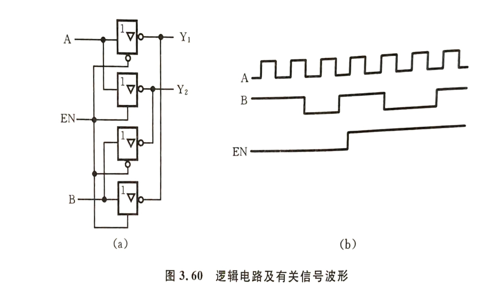
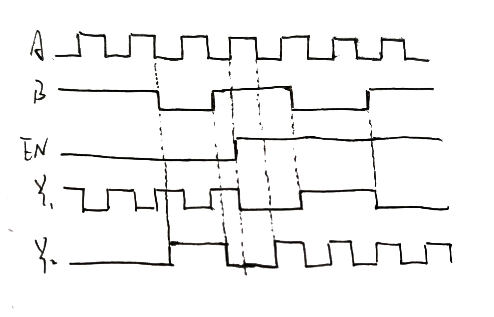

# 2025.9.26 作业

## 复习

1. 了解TTL与非门的工作原理；
2. 了解常用逻辑门电路功能、符号和使用；
3. 了解OC门和三态门的含义；
4. 了解正逻辑和负逻辑的概念；
5. 复习第一章、第二章和第三章的内容；熟记课本76页的逻辑门符号；
6. 熟悉掌握组合逻辑电路设计的步骤和方法

## 作业

课本91页 3.8 课本 114页  4.1 4.2 4.3 4.5 4.6 4.7 4.9 (4.10 4.11 相对难度大)

### p91

3.8 如图 3.60（a）所示为三态门组成的总线换向开关电路，其中A、B为信号输入端，分别送两个频率不同的信号；EN为换向控制端，输入信号和控制电平波形如图（b）所示，试画出 $Y_1、Y_2$ 的波形

 

### p114

.jpg) .jpg)

## 预习

预习  7.1.2，7.1.3
