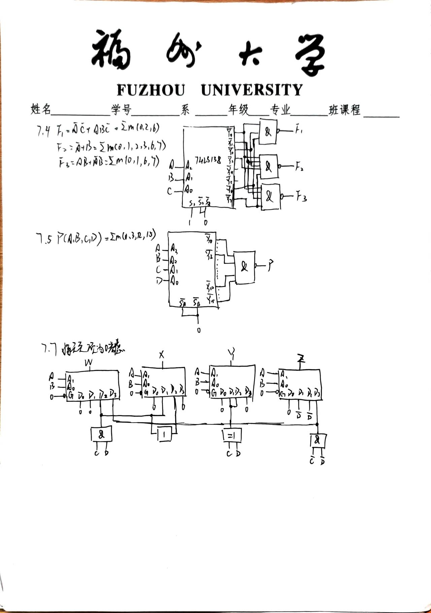

# 2025.10.10 作业

## 复习

1. 掌握组合逻辑电路设计方法
2. 了解掌握变量译码器74139、74138芯片的电路符号、逻辑功能、表达式、真值表，并能熟悉应用芯片；
3. 了解掌握数据选择器74153、741051芯片的逻辑功能，表达式，真值表，并能熟悉应用拓展芯片；
4. 掌握基本RS触发器、钟控RS触发器、D型、JK型触发器、T型触发器的功能、次态卡诺图、次态方程、状态表、状态图、激励表和时序波形图
5. 掌握钟控触发方式、边沿触发方式和主从触发方式的动作特点，掌握采用以上触发方式的RS触发器、J-K触发器和D型触发器的时序波形图的画法。

## 作业

课本 p223 7.4，7.5，7.7, 7.8

7.8 当 4 路选择器的选择控制变量 $A_1、A_0$ 接变量 $A、B$，数据输入端 $D_0、D_1、D_2、D_3$ 依次接 $\overline{C}、0、0、C$ 时，电路实现何功能？

答：实现逻辑函数 $F = \overline{A}\;\overline{B}\;\overline{C} + ABC$

## 预习

预习  5.1 5.2
