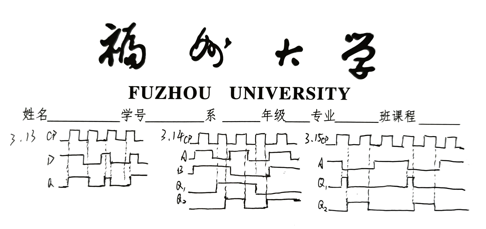

# 2025.10.24 作业

## 复习

1. 掌握基本RS触发器、钟控RS触发器、D型、JK型触发器、T型触发器的功能、次态卡诺图、次态方程、状态表、状态图、激励表和时序波形图。
2. 掌握钟控触发方式、边沿触发方式和主从触发方式的动作特点，掌握采用以上触发方式的RS触发器、J-K触发器和D型触发器的时序波形图的画法。
3. 掌握时序逻辑电路的类型区分，和基本同步时序逻辑电路的分析方法；

## 作业

92页 3.12 3.13 3.14 3.15 151页 5.4 5.5 5.6

3.12 用与非门构成的基本 R-S 触发器和用或非门构成的基本 R-S 触发器在逻辑功能上有什么区别？

答：NAND 型：低有效；NOR 型：高有效；禁止态分别是(0,0)与(1,1)。

3.13 ~ 3.15

5.4 答：此电路为 Mealy 型电路，其输出函数和激励函数为： $Z = xy_1y_2，J_1 = x，K_1 = \overline{x}，J_2 = xy_1，K_2 = \overline{x}$。

列次态真值表可得该电路是一个可重叠的111序列监测器

5.5 答：此电路为 Mealy 型电路，其输出函数和激励函数为： $Z = x\overline{y_1}\;\overline{y_2} + \overline{x}y_1y_2，D_2 = x\overline{y_1} + \overline{x}\;\overline{y_2}y_1，D_1 = \overline{y_1(x \oplus
 y_2)}$。

列次态真值表可得该电路是一个三进制可逆计数器， $x = 0$ 时实现加1计数，反之则为减1计数

5.6 答：此电路为 Mealy 型电路，其输出函数和激励函数为： $Z = x\overline{y_1}\;\overline{y_2} + \overline{x}y_1y_2，J_2 = K_2 = x \oplus y_1，J_1 = K_1 = 1$。

列次态真值表可得该电路是一个模4可逆计数器， $x = 0$ 时实现两位二进制数加1计数，输出为进位信号；反之则为减1计数，输出为借位信号

## 预习

预习  5.2、5.3和实验教程实验一和实验三
