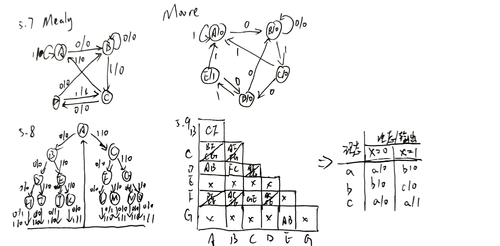
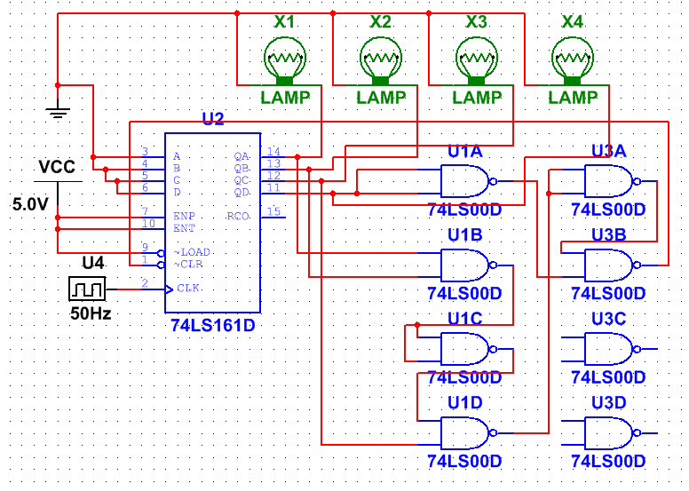
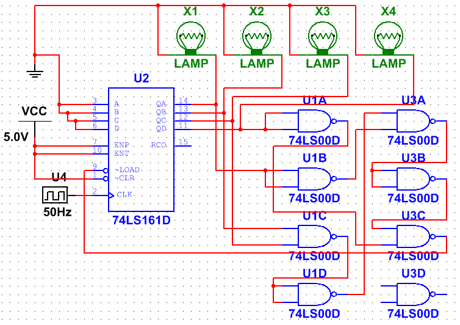

# 2025.11.09 作业

## 复习

1. 掌握时序逻辑电路的三组方程的分析和写法，复习触发器的特性方程。
2. 掌握时序逻辑电路的自启动分析方法。
3. 掌握理解时序逻辑电路的序列检测、计数和分频功能。
4. 掌握同步时序逻辑电路设计的一般步骤
5. 熟练掌握原始状态图和原始状态表的形成。
6. 掌握状态等效，了解隐含表化简法 5.3.2 2状态化简
7. 熟练掌握激励方程（驱动方程）和输出方程的求解。
8. 掌握同步十六进制计数器74161芯片图和逻辑功能。
9. 掌握74161实现任意M进制的方法，区分同步预置和异步复位法的区别。

## 作业

第5章课后作业 5.7 5.8 5.9 5.12 5.13

5.7 ~ 5.9

5.12 答：

- 用 D 触发器 $z = \overline{xy_1}y_2，D_2 = \overline{x}y_1 + x\overline{y_1} + y_1\overline{y_2}，D_1 = \overline{x}y_2 + xy_2$
- 用 T 触发器 $z = \overline{xy_1}y_2，T_2 = x\overline{y_2} + xy_1 + \overline{y_2}y_1 + \overline{x}\;\overline{y_1}y_2，T_1 =x \oplus y_2 \oplus \overline{y_1}$
- 用 JK 触发器 $z = \overline{xy_1}y_2，J_2 = x + y_1，K_2 = x \oplus \overline{y_1}，J_1 = x \oplus \overline{y_2}，K_1 = x \oplus y_2$

故选择最简单的J-K触发器

5.13 答：

用 JK 触发器替代后激励函数和输出函数表达式为：$z = y_2，J_2 = 0，K_2 = x y_1，J_1 = y_2，K_1 = x \oplus \overline{y_2}$

## 附件

> 来自计数器-作业-题目.pdf

### 反馈复位法

| 十进制 | QD QC QB QA(当前) | 下一状态(理想有效) | 备注 |
|------:|-------------------|--------------------|------|
| 0     | 0000              | 0001               |      |
| 1     | 0001              | 0010               |      |
| 2     | 0010              | 0011               |      |
| 3     | 0011              | 0100               |      |
| 4     | 0100              | 0101               |      |
| 5     | 0101              | 0110               |      |
| 6     | 0110              | 0000               | 到 0111 立刻拉回 0000 |
| (7)*  | 0111              | 0000               | *瞬态/无效态 |

### 反馈预置法

| 十进制 | QD QC QB QA(当前) | 下一状态(有效) | 备注 |
|------:|-------------------|----------------|------|
| 0     | 0000              | 0001           |      |
| 1     | 0001              | 0010           |      |
| 2     | 0010              | 0011           |      |
| 3     | 0011              | 0100           |      |
| 4     | 0100              | 0101           |      |
| 5     | 0101              | 0110           |      |
| 6     | 0110              | 0000           | 检测到 6 使 LOAD=0，下一拍同步装载 0000 |
| 7     | 0111              | (不可达)       |      |

## 预习

预习  7.2.1 异步计数器 7.2.2 寄存器 74194
